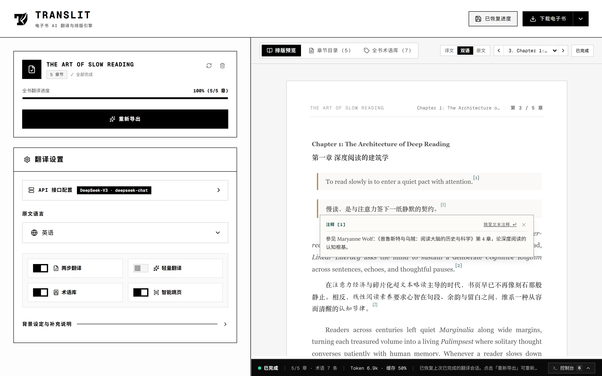

<div align="center">
  
  <h1>TransLit</h1>
  <p>纯前端 EPUB 电子书 AI 翻译、术语一致性控制与出版级排版工坊</p>

  [](https://vite.dev/)
  [](https://react.dev/)
  [](https://www.typescriptlang.org/)
  [](https://tailwindcss.com/)
  
</div>

* [中文说明](#中文说明) | [English Description](#english-description)

---

# 中文说明

**TransLit** 是一款纯前端实现的 EPUB 电子书 AI 翻译与排版重构工具。整条解析、页面分类、脚注内化、翻译分包、术语联动、双语对齐与 EPUB 3 重新打包流程完全在浏览器本地完成，采用 **BYOK**（Bring Your Own Key）直连模式，无需自建中转后端即可保护书籍原文与隐私。

应用采用 **Swiss Monochrome**（黑白 e-ink）极简美学与双栏排版预览工坊界面，专注长篇非虚构、社科与文学著作的高保真中文翻译体验。

## 📸 界面预览

| 双语对照与 EPUB 3 悬浮注脚气泡 | 译文单语书卷感实时排版预览 |
| :---: | :---: |
|  |  |

| 双阶页面分类与章节目录管理 | 全书术语库表格编辑与联动同步 |
| :---: | :---: |
|  |  |

## ✍️ 博客与设计思想

关于 TransLit 的开发思考与 AI 翻译演进记录，欢迎阅读作者的相关博客：
- 📑 [TransLit：AI 翻译电子书之我见](https://joffoo.pages.dev/2026/05/02/translit-ai-translation-ebook/)
- 📑 [TransLit：AI 翻译，多人一步](https://joffoo.pages.dev/2026/05/10/translit-evolution-two-step/)

## ✨ 核心特性

- 🔌 **BYOK 与多 API Profile 管理**
  - 支持在浏览器 `localStorage` 中管理多套 OpenAI 兼容接口档案（如 DeepSeek、NVIDIA NIM、OpenAI、兼容中转等），支持一键拉取可用模型列表、测试接口连通性与切换配置，点击重置进度不会清除个人接口档案。
  - 开发环境内置仅监听本机 `127.0.0.1` 的轻量 CORS 代理中间件（`/__api_proxy`），限制仅允许 `http:` / `https:` 协议以方便本地调试跨源模型接口。
- 🧬 **原位 DOM 变异引擎**（`DomMutationEngine`）
  - 彻底告别传统 Markdown 扁平化往返转换造成的层级丢失：解包后直接识别原书 XHTML 叶子块（包括伪标题类如 `.sec1-titlea`、章首排版表格、引文与内联标签），译后**原位回写**至原始 DOM 骨架，实现零结构差异与跨行对齐（支持 DP 动态规划段落合并/拆分融合）。
  - 预览工坊通过独立组件 [EpubFinishedPreview.tsx](components/EpubFinishedPreview.tsx) 在 `sandbox="allow-same-origin"` 隔离沙箱 `iframe` 中实时渲染成书排版与交互式注脚浮窗。
- 📖 **跨文件注脚纯算法内化与 EPUB 3 原生弹注**
  - **拓扑扫描与内化**（`FootnoteResolver`）：全书解包即时扫描跨文件与同页注脚，按章节命名空间克隆内化至正文章节，支持多段落注脚完整边界提取与清理。
  - **0-Offset 占位保护**：被抽空的独立注脚文件（如 `notes.xhtml`）改写为合规占位页，避免破坏 `content.opf` 与 `toc.ncx` / `nav.xhtml` 结构。
  - **双通道切片与四级容错**（`FootnotePool`）：引用角标封装为不可变槽位 `__FN_REF_{id}__`，正文与待译脚注同车并发翻译，支持上下文引用去重缓存与四级容错回填；导出时写入标准 `<aside epub:type="footnote">` 并在注入阶段进行严格 XML 转义，在微信读书、Apple Books 等现代阅读器中可直接唤起原地浮窗气泡。
- 🧭 **原书语种自动检测与双阶页面分类**
  - 基于 `franc-min` 结合 OPF `<dc:language>` 自动识别原书语言（同时剥离内部占位符防止干扰统计），并自动将语言名称本地化嵌入提示词。
  - **双阶分类器**（`PageClassifier`）：阶段一基于本地规则毫秒级识别版权页/推广页（跳过）、纯图封面（保持原文）、目录及注脚源文件（锁定保护）；阶段二仅对边缘过渡页以受限并发轻量模型裁决，且严格尊重用户手动覆盖结果。
- 🎨 **中式书卷感自适应排版、双语对照与公式支持**
  - **6 种导出变体**：一键导出或打包全部 6 个版本（**纯译文** / **双语原文在前** / **双语译文在前** × **微信读书专版** / **通用电子版**），保证 `mimetype` 作为 ZIP 首个未压缩条目并保留既有 OPF 元数据属性。
  - **纯 Heti 中文语义排版与无 CSS 兜底**：先抽取原书 CSS 语义角色到 `data-translit-role`，面向中文输出自适应注入思源宋体/楷书（`KaiTi` 正体显示斜体内容，避免汉字伪斜体锯齿）；遇到无自带样式表的原生 EPUB 时，自动生成 `translit.css` 并挂载到清单与章节 `<head>`。
  - **KaTeX MathML 数学公式**：回退排版支持块级与行内 LaTeX 渲染为标准 MathML（含货币金额防误匹配保护，避免将 `$10 ... $20` 误解析为公式）。
- 🤖 **互斥策略模式与持久化断点续传**
  - **两步翻译与轻量翻译**：支持高精双阶段模式（初译 + 审校润色）与轻量单 Pass 模式（UI 开关互斥，避免策略冲突）。
  - **全自动断点续传**：章节正文、图片资产、运行日志、术语库与注脚池实时写入浏览器 `IndexedDB`，配置改动亦会防抖持久化。
- 🗂️ **智能术语库管理与章节联动**
  - 翻译过程中自动增量抽取并按后文语境智能过滤冗余术语，表格视图支持原位重命名冲突检测、搜索筛选与一键“**联动已译章节**”批量回写；变更后不会强制弹窗下载，可随时按需点击导出最新版。

## 🎨 视觉系统与品牌标识

- **黑白极简秩序**：采用瑞士现代主义网格线与 `Geist` / `Geist Mono` / `Lora` 排版体系，将控制台收拢为底部可折叠状态胶囊，右侧聚焦全屏成书预览。
- **矢量 Logo**：左上角与水印刷印使用 [logo.svg](logo.svg)，以极简负空间勾勒字母“T”与书页折角轮廓。

## 🛠️ 本地开发与测试

### 前提条件
- 本地安装 [Node.js](https://nodejs.org/)（推荐 v18+）

### 1. 安装依赖
```bash
npm install
```

### 2. 启动开发服务器
```bash
npm run dev
```
启动后在浏览器访问 `http://127.0.0.1:3000` 即可。所有接口密钥直接在页面左侧“**API 接口配置**”面板中添加并保存于浏览器本地，无需手工编写环境变量文件。

### 3. 类型检查、测试与生产构建
```bash
npm run lint    # TypeScript 严格检查（含未使用变量与参数检查）
npm test        # 运行全套自包含核心单元测试（10 项测试）
npm run build   # 分包打包生成 dist/
```

## 📦 项目目录结构

```text
TransLit/
├── components/
│   ├── EpubFinishedPreview.tsx     # 沙箱隔离 iframe 预览与交互式脚注浮窗组件
│   ├── FileUpload.tsx              # EPUB 拖拽上传与进度交互组件
│   └── SettingsPanel.tsx           # 多 API Profile、语种选择与翻译策略面板
├── services/
│   ├── apiProfileService.ts        # Multi-API 档案存储与旧版配置迁移
│   ├── domMutationEngine.ts        # 原位 DOM 变异引擎、Heti 中文语义排版与 XML 转义
│   ├── epubService.ts              # EPUB 解压、CSS 注入、EPUB 3 打包与 KaTeX 渲染
│   ├── footnotePool.ts             # 槽位封装、双通道上下文切片与四级顺位容错
│   ├── footnoteResolver.ts         # 跨文件/同页注脚拓扑解析与 0-Offset 占位生成
│   ├── geminiService.ts            # OpenAI 兼容接口调用、智能分包、重试与增量术语提取
│   ├── languageDetectionService.ts # franc-min 文本与 OPF 元数据原书语种识别
│   ├── pageClassifier.ts           # 双阶页面智能分类器（本地规则 + 受限并发 AI）
│   └── persistenceService.ts       # IndexedDB 会话、章节、图片、日志与术语库持久化
├── utils/
│   ├── chapterUtils.ts             # 章节跳过、仅参考与注脚源判定工具
│   ├── domAdapter.ts               # 浏览器原生 DOM 与 Node/jsdom 双端 XML/HTML 适配器
│   └── glossaryUtils.ts            # 术语表解析、安全正则回写、变化对比与语境去重
├── tests/
│   ├── run_all.ts                  # 一键运行 10 项核心非 UI 测试入口
│   ├── verify_*.ts                 # 单元测试与 Playwright 端到端 UI 测试
├── docs/
│   ├── screenshots/                # README 高清界面演示截图
│   ├── adr/                        # 架构决策记录
│   └── TransLit架构重构.md         # 架构演进与排版引擎技术笔记
├── App.tsx                         # 主控工作台与翻译/打包编排入口
├── prompts.ts                      # 一步/两步翻译系统提示词与术语规则
├── types.ts                        # 全局 TypeScript 数据结构定义
├── logo.svg                        # 极简几何矢量 Logo
├── vite.config.ts                  # Vite 构建分包与本地 CORS 调试代理配置
└── package.json                    # 项目依赖与 npm scripts 定义
```

---

# English Description

**TransLit** is a pure client-side **AI translation and typesetting studio for EPUB e-books**. Parsing, page classification, cross-file footnote internalization, chunked translation, terminology alignment, bilingual weaving, and EPUB 3 packaging all run locally in the browser using the **BYOK (Bring Your Own Key)** model—no backend relay server is required.

The interface follows a **Swiss Monochrome (e-ink inspired)** design system with a live split-screen studio workbench tailored for literary and non-fiction translation into Chinese.

## 📸 Studio Screenshots

| Bilingual Preview & Footnote Popover | Monolingual Heti Chinese Preview |
| :---: | :---: |
|  |  |

| Two-Stage Page Classification & Chapters | Structured Glossary Management & Sync |
| :---: | :---: |
|  |  |

## ✍️ Blogs & Design Philosophy

For design background and translation engineering notes (in Chinese):
- 📑 [TransLit: My Take on AI Translation of E-books](https://joffoo.pages.dev/2026/05/02/translit-ai-translation-ebook/)
- 📑 [TransLit: AI Translation, One Step Ahead](https://joffoo.pages.dev/2026/05/10/translit-evolution-two-step/)

## ✨ Key Features

- 🔌 **BYOK & Multi-API Profile Manager**
  - Manage multiple OpenAI-compatible API profiles in `localStorage`, fetch available models, verify live connectivity, and switch profiles without losing session progress when resetting a book.
  - Includes a dev-only CORS proxy (`/__api_proxy`) bound to `127.0.0.1` and restricted strictly to `http:` / `https:` targets.
- 🧬 **In-Place DOM Mutation Engine** (`DomMutationEngine`)
  - Eliminates lossy HTML-to-Markdown roundtrips (`turndown` has been completely removed). Translatable leaf blocks and inline markup are extracted in place and mutated back into the original XHTML skeleton with **zero structural tree drift**, including dynamic programming paragraph split/merge alignment.
  - [EpubFinishedPreview.tsx](components/EpubFinishedPreview.tsx) renders chapters inside an isolated `sandbox="allow-same-origin"` `iframe` with interactive footnote popovers.
- 📖 **Deterministic Cross-File Footnotes & Native EPUB 3 Popups**
  - `FootnoteResolver` builds a global topology map across XHTML files, internalizes multi-paragraph cross-file and same-page notes with per-chapter namespaces, and rewrites drained standalone note files into 0-Offset placeholders so `content.opf` and `toc.ncx` / `nav.xhtml` remain intact.
  - `FootnotePool` seals citations in opaque `__FN_REF_{id}__` slots with 4-level fallback recovery and emits XML-escaped `<aside epub:type="footnote">` popups compatible with WeChat Read and Apple Books.
- 🧭 **Language Auto-Detection & Two-Stage Page Classifier**
  - Automatically identifies the source language via `franc-min` (with slot stripping so placeholder tokens do not bias short chapters) and OPF `<dc:language>` fallback.
  - `PageClassifier` applies instant local heuristics (skipping copyright/promo pages, keeping media-only covers untouched, locking footnote source files) and bounded-concurrency lightweight AI verdicts for ambiguous transition pages.
- 🎨 **Adaptive Chinese Typography, 6 Export Editions & KaTeX MathML**
  - Exports any single variant or all 6 editions in a bundle (**Monolingual** / **Bilingual Source-First** / **Bilingual Target-First** × **WeChat Read Edition** / **Universal Edition**), ensuring `mimetype` is written as the first uncompressed ZIP entry.
  - Maps Chinese italics to upright KaiTi fonts via adaptive Heti typography and automatically generates and links `translit.css` if the source EPUB ships without stylesheets.
  - Renders block and inline LaTeX formulas via KaTeX MathML in Markdown fallback flows with currency-price safeguards (e.g., `"$10 and $20"` stays plain text).
- 💾 **Resumable** `IndexedDB` **Persistence & Glossary Sync**
  - Saves chapters, extracted images, token statistics, console logs, glossary entries, and debounced configuration updates in `IndexedDB`.
  - Supports inline glossary editing with rename collision checks and one-click cascading replacement back into translated chapters.

## 🛠️ Local Development & Verification

### Prerequisites
- [Node.js](https://nodejs.org/) v18+

### Setup & Commands
```bash
npm install       # Install dependencies
npm run dev       # Start local dev server at http://127.0.0.1:3000
npm run lint      # Run TypeScript check (noUnusedLocals + noUnusedParameters)
npm test          # Execute self-contained verification suite (10 suites)
npm run build     # Build production bundle into dist/
```

---

## 📜 License

This project is open source under the MIT License.
