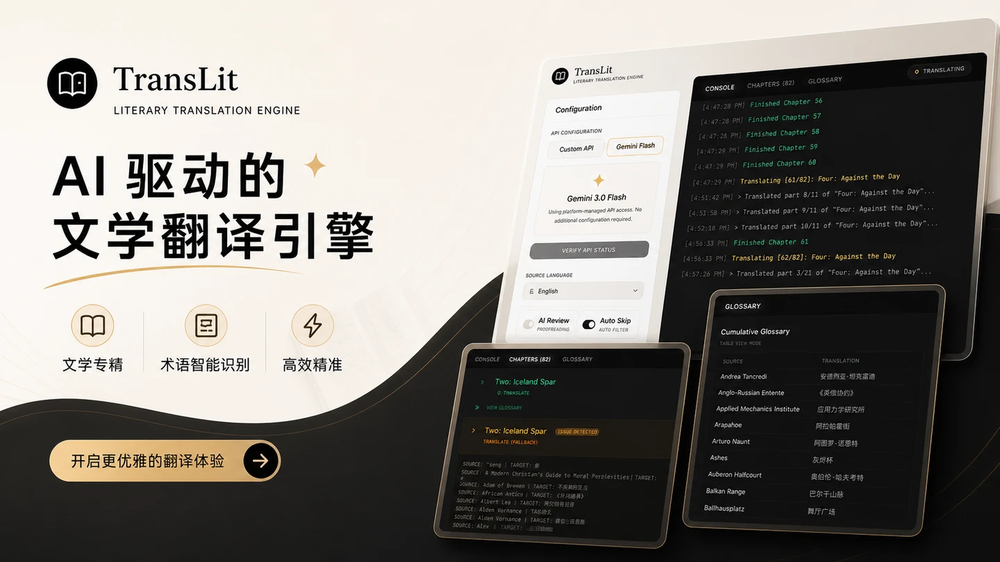

# TransLit 📖

[](https://vite.dev/)
[](https://react.dev/)
[](https://developer.mozilla.org/en-US/docs/Web/CSS)
[](LICENSE)

<div align="center">

</div>

* [中文版](#中文说明) | [English Version](#english-description)

---

# 中文说明

**TransLit** 是一款基于前端实现的 EPUB 电子书 AI 翻译与术语工具。它支持在浏览器中解析、翻译、校对和重新打包 EPUB 电子书，支持 BYOK (Bring Your Own Key) 直连模式，无需中转后端服务，保护书籍隐私。

应用界面采用 **Swiss Monochrome (黑白 e-ink)** 设计风格，旨在为文学翻译创作者提供专注的交互体验。

## ✍️ 博客与设计思想

关于 TransLit 的开发思考与 AI 翻译演进记录，欢迎阅读作者的相关博客：
- 📑 [TransLit：AI 翻译电子书之我见](https://joffoo.pages.dev/2026/05/02/translit-ai-translation-ebook/)
- 📑 [TransLit：AI 翻译，多人一步](https://joffoo.pages.dev/2026/05/10/translit-evolution-two-step/)

## ✨ 核心特性

- 🔌 **BYOK (Bring Your Own Key) 模式**
  - 无需搭建中转服务器，API 接口由浏览器直连调用。
  - 用户的 API Key、Base URL 等配置会缓存到浏览器的 `localStorage` 中。在点击 “Reset” 重置书籍和日志进度时，个人的 API 密钥等配置不会被清理。
- 📖 **EPUB 解析与重新打包**
  - 基于 `jszip` 库解压并解析 EPUB，提取 `content.opf` 以及 XHTML 章节内容。
  - 内置纯算法跨文件注脚拓扑解析器（`FootnoteResolver`），自动扫描全书注脚并内化绑定到宿主章节，支持 0-Offset 占位保护。
  - 支持 EPUB 3 原生弹出式注脚（`<aside epub:type="footnote">`），在 Apple Books、微信读书等现代阅读器中直接激活悬浮气泡，免跳转阅读。
  - 双阶页面智能分类器（`PageClassifier`）：本地硬规则毫秒级预判 + 轻量级 AI 辅助过渡页决策（保留原文/翻译/剔除）。
  - 保险箱插槽与双通道上下文感知切片（`FootnotePool`）：角标封入不可变占位符，正文与关联注脚同车并发翻译，支持四级顺位容错映射与即时增量持久化。
  - 使用 `turndown` 库将 XHTML 转换为 Markdown 格式提供给大模型，保证格式、加粗、排版及注释等在翻译后得到保留。
- 💾 **持久化 (断点续传)**
  - 基于浏览器 `IndexedDB` 存储当前的会话状态、章节解析内容、图片资产、运行中的日志，以及生成的术语表与注脚池。
  - 即使网络中断、电脑死机或页面刷新，也能断点恢复，继续之前的翻译进度。
- 🤖 **双 Pass 翻译与校对**
  - **分包处理**：自动按约 3000 字（单 Pass）或 1800 字（双 Pass 润色）进行智能拆包。
  - **双 Pass 润色**：除单 Pass 翻译外，支持开启 “Proofreading (校对与润色)” 双阶段处理。结合输入的翻译上下文，产出高质量中文译文。
- 🗂️ **术语库与一致性**
  - 抽取、记录章节中的生僻词与专有实体。
  - **一致性指令**：在系统提示词层面对齐翻译结果，减少大模型在长文翻译中的“人名/术语漂移”现象。
  - 结合后文语境清理、过滤只出现一次的术语，保证术语库的紧凑。

## 📖 电子书原生注脚支持（纯算法内化，无需前置预处理）

在最新版本中，TransLit 已内置跨文件注脚拓扑图解析与 EPUB 3 原生弹出式注脚生成能力，**无需借助任何外部 AI 前置脚本处理注脚**：
- **纯算法内化**：全书解包即时构建拓扑图，将原本存放在 `notes.xhtml` 或 `endnotes.xhtml` 中的跨文件注脚自动内化绑定至各自正文章节（带章节命名空间防碰撞）。
- **0-Offset 占位保护**：原独立注脚文件写入友好提示占位，保留骨架，100% 避免破坏 `content.opf` 清单和 `toc.ncx` / `nav.xhtml` 目录结构。
- **EPUB 3 原生气泡交互**：正文角标渲染为标准 `<a epub:type="noteref">`，章末生成 `<aside epub:type="footnote">`，微信读书和 Apple Books 均可点击直接弹出浮窗。
- *(可选兼容)* 对于早期制作非标准的遗留书籍，仍可参考外部技能脚本 [translit-epub-prep](https://github.com/fengyukongzhou/translit-epub-prep) 进行辅助洗排。

## 🎨 设计美学：Swiss Monochrome

项目界面参考了瑞士现代主义排版与 e-ink 电子墨水屏美学：
- **留白与黑白对比**：使用粗体无衬线等宽字体（Geist Mono）与网格线条。
- **黑白交互**：所有输入框、开关按钮、标签和控制台均由黑白两色构成。
- **Logo**：左上角使用从 `logo.png` 提取并裁剪的黑白软盘 SVG 矢量 Logo，与页面融合。

## 🛠️ 本地运行指南

### 前提条件
- 本地需要安装 [Node.js](https://nodejs.org/) (推荐 v18+)

### 1. 安装依赖
```bash
npm install
```

### 2. 配置环境变量 (可选)
您可以在项目根目录中复制或创建 `.env.local` 文件来预填默认 API Key：
```env
GEMINI_API_KEY=您的Gemini密钥
```
*注：在 UI 界面中输入的 Key 优先级最高，且会自动记录至 LocalStorage。*

### 3. 运行开发服务器
```bash
npm run dev
```
启动后在浏览器打开终端提示的地址（默认 `http://localhost:3000`）即可。

## 📦 项目架构简析

```
TransLit/
├── components/
│   ├── FileUpload.tsx         # 电子书拖拽上传组件
│   └── SettingsPanel.tsx      # API 与翻译策略配置面板
├── services/
│   ├── epubService.ts         # 负责 EPUB 解压、Markdown 转换与重新封包
│   ├── footnoteResolver.ts    # 纯算法跨文件注脚拓扑解析与 0-Offset 占位保护
│   ├── pageClassifier.ts      # 双阶页面智能分类器（本地硬规则 + 轻量 AI）
│   ├── footnotePool.ts        # 保险箱插槽、双通道切片与四级顺位容错映射
│   ├── geminiService.ts       # API 调用，处理分包、翻译与校对流程
│   └── persistenceService.ts  # IndexedDB 持久化读写服务
├── App.tsx                    # 主程序框架，控制核心状态流转与双面板布局
├── index.html                 # HTML 骨架，配置全局 Geist Mono 字体与滚动条样式
├── logo.svg                   # 软盘矢量 Logo
└── package.json               # 项目依赖声明
```

---

# English Description

**TransLit** is a client-side **EPUB AI translation and glossary tool for translating books into Chinese**. It supports parsing, translating, proofreading, and packaging EPUB e-books in the browser. By adopting the BYOK (Bring Your Own Key) model, it communicates with AI APIs without intermediate back-end servers, protecting privacy for your books.

The user interface implements a **Swiss Monochrome (e-ink style)** design language, providing a focused workspace.

## ✍️ Blogs & Design Philosophy

For the author's thoughts on TransLit's development and the evolution of AI translation, check out the following blog posts (in Chinese):
- 📑 [TransLit: My Take on AI Translation of E-books](https://joffoo.pages.dev/2026/05/02/translit-ai-translation-ebook/)
- 📑 [TransLit: AI Translation, One Step Ahead](https://joffoo.pages.dev/2026/05/10/translit-evolution-two-step/)

## ✨ Key Features

- 🔌 **BYOK (Bring Your Own Key) Mode**
  - No server-side setup required; API calls are sent from the browser.
  - User settings (API Key, Base URL, etc.) are cached in the browser's `localStorage`. Resetting the translation progress will not clear your API keys.
- 📖 **EPUB Parsing & Native EPUB 3 Footnotes**
  - Unzips and parses EPUB using `jszip` to extract XHTML chapters and metadata.
  - **Deterministic Footnote Resolver**: Automatically scans cross-file footnotes, clones and internalizes them with chapter namespaces, and preserves 0-Offset placeholders for spine and NCX/Nav integrity.
  - **Native EPUB 3 Popup Footnotes**: Renders `<aside epub:type="footnote">` popups, enabling native floating bubble interactions in Apple Books, WeChat Read, etc.
  - **Two-Stage Page Classifier**: Zero-latency local rules + lightweight AI for transition pages (keep original / translate / skip).
  - **Context-Aware Dual-Channel Chunker**: Protects citations via opaque slots (`__FN_REF_{id}__`) and feeds body text and notes side-by-side with 4-level fallback mapping.
- 💾 **Persistence (Resumable Progress)**
  - Stores session states, chapter extractions, images, logs, generated glossary terms, and translated footnote pools in `IndexedDB`.
  - Resumes translation progress after network disconnections, browser crashes, or page reloads.
- 🤖 **Two-Pass Translation & Proofreading**
  - **Chunk Splitter**: Splits chapters into ~3000 words (single-pass) or ~1800 words (two-pass polish).
  - **Two-Pass Polish**: Supports an optional "Proofreading" stage following the initial translation pass.
- 🗂️ **Glossary & Consistency**
  - Extracts and logs rare words and proper nouns during translation.
  - **Consistency Rule**: Applies consistency rules at the system prompt level to reduce term drift.

## 📖 EPUB Native Footnote Support (Zero Preprocessing Required)

TransLit now features a fully deterministic, in-browser footnote resolution pipeline:
- **Pure Algorithm Resolution**: Builds full-book topology upon unpacking, binding external notes (`notes.xhtml`, `endnotes.xhtml`) to referring chapters with chapter namespaces.
- **0-Offset Placeholder Guarantee**: Drained note files are retained as friendly placeholders, preserving `content.opf` and navigation tree integrity.
- **EPUB 3 Popup Footnotes**: Translates into native `<a epub:type="noteref">` and `<aside epub:type="footnote">` tags.
- *(Legacy fallback)*: External preprocessing via [translit-epub-prep](https://github.com/fengyukongzhou/translit-epub-prep) remains available for non-standard books.

## 🎨 Design Philosophy: Swiss Monochrome

The interface references Swiss typography and e-ink aesthetics:
- **Contrast Grid Layout**: Uses bold monospace typography (Geist Mono) and border lines.
- **Binary Interaction**: All inputs, switches, badges, and consoles are rendered in black and white.
- **Logo**: Incorporates a vectorized floppy disk SVG logo, blending into the header.

## 🛠️ Local Setup Guide

### Prerequisites
- [Node.js](https://nodejs.org/) (v18+ recommended) installed locally.

### 1. Install Dependencies
```bash
npm install
```

### 2. Set Up Environment Variables (Optional)
You can create a `.env.local` file in the root directory to auto-fill your default API key:
```env
GEMINI_API_KEY=your_gemini_api_key_here
```
*Note: Keys entered in the Web UI have higher priority and are stored in LocalStorage.*

### 3. Run Development Server
```bash
npm run dev
```
Open the local URL (default: `http://localhost:3000`) shown in your terminal.

---

## 📜 License

This project is licensed under the [MIT License](LICENSE).
