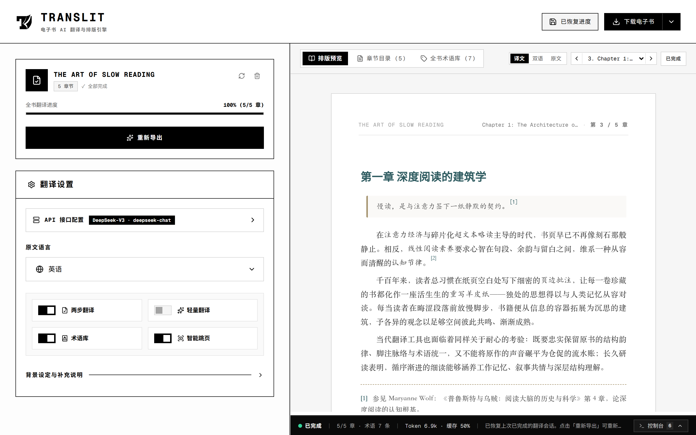
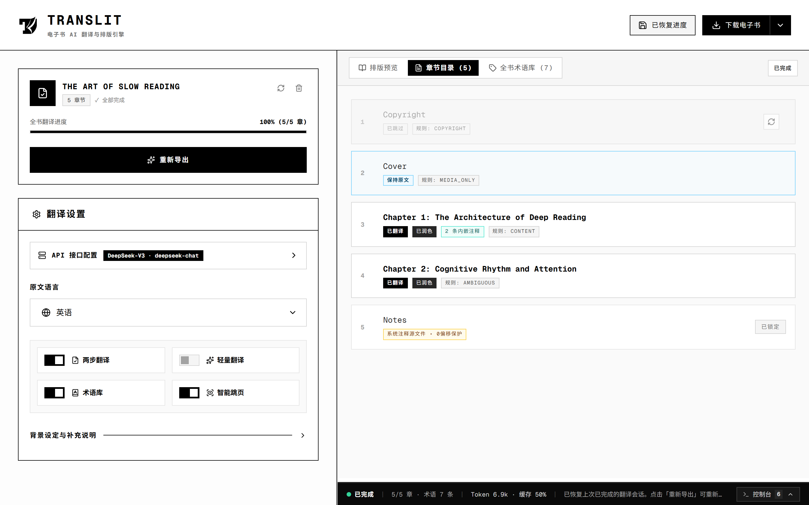
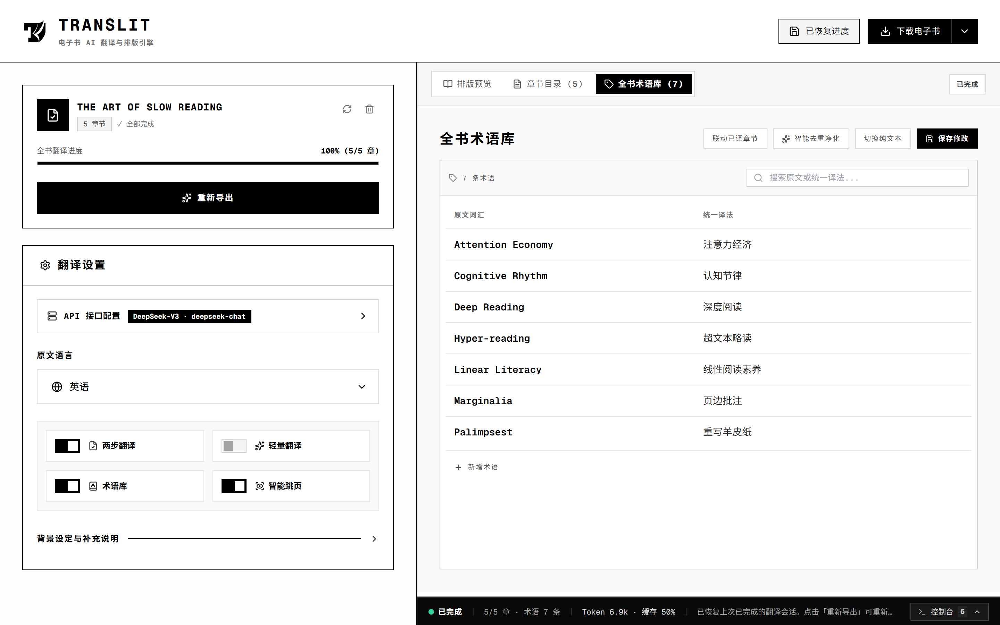

<div align="center">
  
  <h1>TransLit</h1>
  <p>纯前端 EPUB 电子书 AI 翻译、术语一致性控制与出版级排版工坊</p>

  [](https://vite.dev/)
  [](https://react.dev/)
  [](https://www.typescriptlang.org/)
  [](https://tailwindcss.com/)
  
</div>

* [中文说明](#中文说明) | [English Description](#english-description)

---

# 中文说明

**TransLit** 是一款纯前端实现的 EPUB 电子书 AI 翻译与排版重构工具。整条解析、页面分类、脚注内化、翻译分包、术语联动、双语对齐与 EPUB 3 重新打包流程完全在浏览器本地完成，采用 **BYOK**（Bring Your Own Key）直连模式，无需自建中转后端即可保护书籍原文与隐私。

应用采用 **Swiss Monochrome**（黑白 e-ink）极简美学与双栏排版预览工坊界面，专注长篇非虚构、社科与文学著作的高保真中文翻译体验。

## 📸 界面预览

| 双语对照与 EPUB 3 悬浮注脚气泡 | 译文单语书卷感实时排版预览 |
| :---: | :---: |
|  |  |

| 双阶页面分类与章节目录管理 | 全书术语库表格编辑与联动同步 |
| :---: | :---: |
|  |  |

## ✍️ 博客与设计思想

关于 TransLit 的开发思考与 AI 翻译演进记录，欢迎阅读作者的相关博客：
- 📑 [TransLit：AI 翻译电子书之我见](https://joffoo.pages.dev/2026/05/02/translit-ai-translation-ebook/)
- 📑 [TransLit：AI 翻译，多人一步](https://joffoo.pages.dev/2026/05/10/translit-evolution-two-step/)

## ✨ 核心特性

- 🔌 **BYOK 与多 API Profile 管理**
  - 支持在浏览器 `localStorage` 中管理多套 OpenAI 兼容接口档案（如 DeepSeek、NVIDIA NIM、OpenAI、兼容中转等），支持一键拉取可用模型列表、测试接口连通性与切换配置，点击重置进度不会清除个人接口档案。
  - 内置同源轻量 CORS 代理（`/__api_proxy`），同时支持本地 Vite 开发/预览中间件、Cloudflare Workers（[wrangler.jsonc](wrangler.jsonc) + [cloudflare/worker.ts](cloudflare/worker.ts)）与 Cloudflare Pages Functions（[functions/__api_proxy.ts](functions/__api_proxy.ts)），并自动兼容省略 `/v1` 的裸域名接口地址；本地 Vite 中间件通过 `undici` 的 `EnvHttpProxyAgent` 自动感知 `HTTP_PROXY`/`HTTPS_PROXY`（失败时回退直连），透出底层错误码与 `x-translit-proxy-error: 1`，浏览器端 `fetchViaProxyOrDirect` 在代理返回 `502` 或纯静态托管环境下自动回退为浏览器直连。
- 🧬 **原位 DOM 变异引擎与显式块编号协议**（`DomMutationEngine` / `blockProtocol`）
  - **显式块编号协议**（Block-ID Wire Protocol）：发送模型前通过 `encodeBlocksForWire` 为每个 DOM 叶子块赋予 `[B1]`、`[B2]`……确定性编号并在传输层剥离 `#` 前缀，彻底消除与“严禁输出 `#`”提示词的冲突；回写前 `decodeBlocksFromWire` 按编号严格重排回 `1..K` 顺序并将块内意外空行折叠为 `<br/>`，从协议层杜绝段落调换、章标题并入正文、居中铭牌丢失与双语错行，同时向下兼容无 `[Bk]` 标记的旧缓存；`splitTextIntoChunks` 同步加入标题不孤立规则，避免小标题被单独切在分片末尾。
  - **输入/输出双向 XHTML 语法屏障**：彻底告别传统 Markdown 扁平化往返转换造成的层级丢失。输入侧 `extractLeafBlockContent` 按样式语义剥离装饰性 `<span>` 与非脚注行内 `<a>`（如 `role="doc-backlink"`，并在 `writeHtmlIntoLeafElement` 保留 `<a id="..."></a>` 锚点），将强调/加粗/代码 `<span>` 归一化为标准 `<i>`/`<b>`/`<code>`；输出侧 `sanitizeInlineXhtmlForLeaf` 抢救漏掉 `>` 的畸形标签、清洗中文引号属性、剥离非白名单 HTML 外壳标签（杜绝明文 `&lt;a...&gt;` 泄漏）并转义正文 `<`/`>`/`&`。
  - **容错对齐与编码哨兵**：支持单换行列表/小标题边界恢复（`recoverSingleNewlineBoundaries`）、`4->1` DP 动态规划合并隐藏（`data-translit-merged="true"`）与 `N === M` 相邻标题/正文倒挂兜底，并新增 `\uFFFD` 编码乱码字符检测预警。
  - 预览工坊通过独立组件 [EpubFinishedPreview.tsx](components/EpubFinishedPreview.tsx) 在 `sandbox="allow-same-origin"` 隔离沙箱 `iframe` 中实时渲染成书排版与交互式注脚浮窗。
- 📖 **跨文件注脚纯算法内化与 EPUB 3 原生弹注**
  - **拓扑扫描与内化**（`FootnoteResolver`）：全书解包即时扫描跨文件与同页注脚，按章节命名空间克隆内化至正文章节，支持多段落注脚完整边界提取与清理。
  - **0-Offset 占位保护**：被抽空的独立注脚文件（如 `notes.xhtml`）改写为合规占位页，避免破坏 `content.opf` 与 `toc.ncx` / `nav.xhtml` 结构。
  - **双通道切片与四级容错**（`FootnotePool`）：引用角标封装为不可变槽位 `__FN_REF_{id}__`，正文与待译脚注同车并发翻译，支持上下文引用去重缓存、四级容错回填、中文六角括号 `〔1〕` 与 `（脚注 1）` 内联还原及同行连排泄漏注释剥离；导出时写入标准 `<aside epub:type="footnote">` 并在注入阶段进行严格 XML 转义，在微信读书、Apple Books 等现代阅读器中可直接唤起原地浮窗气泡。
- 🧭 **原书语种自动检测与双阶页面分类**
  - 基于 `franc-min` 结合 OPF `<dc:language>` 自动识别原书语言（同时剥离内部占位符防止干扰统计），并自动将语言名称本地化嵌入提示词。
  - **双阶分类器**（`PageClassifier`）：阶段一基于本地规则毫秒级识别版权页/推广页（跳过）、纯图封面（保持原文）、目录及注脚源文件（锁定保护）；阶段二仅对边缘过渡页以受限并发轻量模型裁决，且严格尊重用户手动覆盖结果。
- 🎨 **1-Shot AI 样式分类、纯赫蹏无色自适应排版与多版本导出**
  - **1-Shot AI CSS 语义样式分类器**（`StyleClassifier`）：先对全书 CSS 执行样式普查（`buildBookStyleCensus`）并生成本地零 token 确定性兜底（`deriveLocalStyleRoles`），仅在用户点击“**开始翻译**”后按需触发一次全书 1-Shot AI 语义分类（`classifyBookStyles`），将类名映射为正交排版角色（`h1`~`h4`、`subtitle`、`body`、`quote`、`callout`、`attribution`、`epigraph`、`verse`、`hanging`、`caption`、`meta`、`dropcap`、`emphasis`、`strong`、`code`、`ignore`）；导入 EPUB 与恢复会话零 token 消耗。
  - **纯赫蹏黑白单色主题自适应 CSS**（`buildAdaptiveChineseTypographyCss`）：零硬编码色值（0 hardcoded hex），全面继承阅读器文字与背景色，适配日间/护眼/深色主题；中和西文首字下沉（`dropcap`/`.stickupcap`）、防止引用块嵌套叠框、保留强调与粗体样式（楷体正排斜体）；自动识别原书 `list-style-type: none` / 悬挂缩进 / 手工编号列表并标记 `data-translit-list="none"` 抑制阅读器重复序号（避免 `1. 1.`），同时依原书 CSS `padding-left`/`margin-left` 保留空占位 `<span>` 间距；遇到无自带样式表的原生 EPUB 时，自动生成 `translit.css` 并挂载到清单与章节 `<head>`。
  - **6 种导出变体与 KaTeX MathML**：一键导出或打包全部 6 个版本（**纯译文** / **双语原文在前** / **双语译文在前** × **微信读书专版** / **通用电子版**），保证 `mimetype` 作为 ZIP 首个未压缩条目并保留既有 OPF 元数据属性；回退排版支持块级与行内 LaTeX 渲染为标准 MathML（含货币金额防误匹配保护）。
- 🤖 **互斥策略模式与持久化断点续传**
  - **两步翻译与轻量翻译**：支持高精双阶段模式（初译 + 审校润色）与轻量单 Pass 模式（UI 开关互斥，避免策略冲突）。
  - **全自动断点续传**：章节正文、图片资产、运行日志、术语库与注脚池实时写入浏览器 `IndexedDB`，配置改动亦会防抖持久化。
- 🗂️ **智能术语库管理与章节联动**
  - 翻译过程中自动增量抽取并按后文语境智能过滤冗余术语，表格视图支持原位重命名冲突检测、搜索筛选与一键“**联动已译章节**”批量回写；变更后不会强制弹窗下载，可随时按需点击导出最新版。

## 🎨 视觉系统与品牌标识

- **黑白极简秩序**：采用瑞士现代主义网格线与 `Geist` / `Geist Mono` / `Lora` 排版体系，将控制台收拢为底部可折叠状态胶囊，右侧聚焦全屏成书预览。
- **矢量 Logo**：左上角与水印刷印使用 [logo.svg](logo.svg)，以极简负空间勾勒字母“T”与书页折角轮廓。

## 🛠️ 本地开发与测试

### 前提条件
- 本地安装 [Node.js](https://nodejs.org/)（推荐 v18+）

### 1. 安装依赖
```bash
npm install
```

### 2. 启动开发服务器
```bash
npm run dev
```
启动后在浏览器访问 `http://127.0.0.1:3000` 即可。所有接口密钥直接在页面左侧“**API 接口配置**”面板中添加并保存于浏览器本地，无需手工编写环境变量文件。

### 3. 类型检查、测试、CLI 审计与生产构建
```bash
npm run lint    # TypeScript 严格检查（含未使用变量与参数检查）
npm test        # 运行全套自包含核心单元测试（13 项测试）
npm run cli     # 命令行质量审计与翻译工具（sample / inspect / classify-styles / render --strict / translate）
npm run build   # 分包打包生成 dist/
```

## 📦 项目目录结构

```text
TransLit/
├── cloudflare/
│   └── worker.ts                   # Cloudflare Workers 同源 CORS 代理与错误透传入口
├── functions/
│   └── __api_proxy.ts              # Cloudflare Pages Functions 同源 CORS 代理入口
├── components/
│   ├── EpubFinishedPreview.tsx     # 沙箱隔离 iframe 预览与交互式脚注浮窗组件
│   ├── FileUpload.tsx              # EPUB 拖拽上传与进度交互组件
│   └── SettingsPanel.tsx           # 多 API Profile、语种选择与翻译策略面板
├── scripts/
│   └── translit-cli.ts             # CLI 抽样、结构检查、样式分类、严格渲染审计与翻译工具
├── services/
│   ├── apiProfileService.ts        # Multi-API 档案存储与旧版配置迁移
│   ├── domMutationEngine.ts        # 原位 DOM 变异引擎、双向 XHTML 语法屏障与容错对齐
│   ├── epubService.ts              # EPUB 解压、纯赫蹏无色自适应 CSS 注入、EPUB 3 打包与 KaTeX 渲染
│   ├── footnotePool.ts             # 槽位封装、双通道切片、六角括号/泄漏注释处理与四级容错
│   ├── footnoteResolver.ts         # 跨文件/同页注脚拓扑解析与 0-Offset 占位生成
│   ├── geminiService.ts            # OpenAI 兼容接口调用、代理/直连回退、标题不孤立分包与乱码预警
│   ├── languageDetectionService.ts # franc-min 文本与 OPF 元数据原书语种识别
│   ├── pageClassifier.ts           # 双阶页面智能分类器（本地规则 + 受限并发 AI）
│   ├── persistenceService.ts       # IndexedDB 会话、章节、图片、日志与术语库持久化
│   └── styleClassifier.ts          # 全书 CSS 普查、零 token 本地兜底与 1-Shot AI 语义样式分类
├── utils/
│   ├── blockProtocol.ts            # 显式块编号协议（[B1]/[B2]... 编解码、# 剥离与顺序重排）
│   ├── chapterUtils.ts             # 章节跳过、仅参考与注脚源判定工具
│   ├── domAdapter.ts               # 浏览器原生 DOM 与 Node/jsdom 双端 XML/HTML 适配器
│   └── glossaryUtils.ts            # 术语表解析、安全正则回写、变化对比与语境去重
├── tests/
│   ├── run_all.ts                  # 一键运行 13 项核心非 UI 测试入口
│   ├── verify_*.ts                 # 单元测试（含样式分类、块协议等）与 Playwright UI 测试
├── docs/
│   ├── screenshots/                # README 高清界面演示截图
│   ├── adr/                        # 架构决策记录
│   └── TransLit架构重构.md         # 架构演进与排版引擎技术笔记
├── App.tsx                         # 主控工作台、按需 1-Shot 样式分类与打包编排入口
├── prompts.ts                      # 一步/两步翻译提示词、块编号铁律与术语提取规则
├── types.ts                        # 全局 TypeScript 数据结构定义
├── logo.svg                        # 极简几何矢量 Logo
├── vite.config.ts                  # Vite 构建分包与支持环境代理感知的本地 CORS 调试代理
├── wrangler.jsonc                  # Cloudflare Workers 静态资产与路由配置
└── package.json                    # 项目依赖与 npm scripts 定义
```

---

# English Description

**TransLit** is a pure client-side **AI translation and typesetting studio for EPUB e-books**. Parsing, page classification, cross-file footnote internalization, chunked translation, terminology alignment, bilingual weaving, and EPUB 3 packaging all run locally in the browser using the **BYOK (Bring Your Own Key)** model—no backend relay server is required.

The interface follows a **Swiss Monochrome (e-ink inspired)** design system with a live split-screen studio workbench tailored for literary and non-fiction translation into Chinese.

## 📸 Studio Screenshots

| Bilingual Preview & Footnote Popover | Monolingual Heti Chinese Preview |
| :---: | :---: |
|  |  |

| Two-Stage Page Classification & Chapters | Structured Glossary Management & Sync |
| :---: | :---: |
|  |  |

## ✍️ Blogs & Design Philosophy

For design background and translation engineering notes (in Chinese):
- 📑 [TransLit: My Take on AI Translation of E-books](https://joffoo.pages.dev/2026/05/02/translit-ai-translation-ebook/)
- 📑 [TransLit: AI Translation, One Step Ahead](https://joffoo.pages.dev/2026/05/10/translit-evolution-two-step/)

## ✨ Key Features

- 🔌 **BYOK & Multi-API Profile Manager**
  - Manage multiple OpenAI-compatible API profiles in `localStorage`, fetch available models, verify live connectivity, and switch profiles without losing session progress when resetting a book.
  - Includes a built-in same-origin CORS proxy (`/__api_proxy`) across Vite dev/preview, Cloudflare Workers ([wrangler.jsonc](wrangler.jsonc) + [cloudflare/worker.ts](cloudflare/worker.ts)), and Cloudflare Pages Functions ([functions/__api_proxy.ts](functions/__api_proxy.ts)), with automatic `/v1` endpoint fallback for bare domain URLs. Local Vite middleware automatically detects `HTTP_PROXY`/`HTTPS_PROXY` via `undici` `EnvHttpProxyAgent` (falling back to direct connection on error) and surfaces underlying error codes with `x-translit-proxy-error: 1`; `fetchViaProxyOrDirect` falls back to direct browser fetch on proxy `502` responses or static-only hosts.
- 🧬 **In-Place DOM Mutation, Block-ID Wire Protocol & Bidirectional XHTML Barrier** (`DomMutationEngine` / `blockProtocol`)
  - **Explicit Block-ID Wire Protocol**: `encodeBlocksForWire` assigns deterministic `[B1]`, `[B2]`, ... prefixes to each extracted DOM leaf block and strips leading `#` on the wire so it never conflicts with the prompt's no-`#` rule. Before write-back, `decodeBlocksFromWire` reorders blocks strictly back to `1..K`, folds accidental blank lines within a single block into `<br/>`, eliminates paragraph swaps/heading merges/bilingual drift, and remains backward-compatible with legacy caches without `[Bk]` markers. `splitTextIntoChunks` also enforces heading non-isolation so subheadings are never orphaned at the end of a chunk.
  - **Bidirectional XHTML Syntax Barrier**: Eliminates lossy HTML-to-Markdown roundtrips (`turndown` has been completely removed). On input, `extractLeafBlockContent` strips decorative `<span>` and non-footnote inline `<a>` (such as `role="doc-backlink"`, preserving `<a id="..."></a>` anchors in `writeHtmlIntoLeafElement`) while normalizing emphasis/strong/code spans to `<i>`/`<b>`/`<code>`. On output, `sanitizeInlineXhtmlForLeaf` rescues malformed tags missing `>`, cleans Chinese quotes inside attributes, strips non-whitelisted HTML shell tags (preventing literal `&lt;a...&gt;` leaks), and escapes literal `<`/`>`/`&`.
  - **Resilient Alignment & Garble Guard**: Includes single-newline list/subheading boundary recovery (`recoverSingleNewlineBoundaries`), `4->1` DP merge hiding (`data-translit-merged="true"`), an `N === M` adjacent heading/body swap guard, and `\uFFFD` encoding replacement-character detection (`countReplacementChars`).
  - [EpubFinishedPreview.tsx](components/EpubFinishedPreview.tsx) renders chapters inside an isolated `sandbox="allow-same-origin"` `iframe` with interactive footnote popovers.
- 📖 **Deterministic Cross-File Footnotes & Native EPUB 3 Popups**
  - `FootnoteResolver` builds a global topology map across XHTML files, internalizes multi-paragraph cross-file and same-page notes with per-chapter namespaces, and rewrites drained standalone note files into 0-Offset placeholders so `content.opf` and `toc.ncx` / `nav.xhtml` remain intact.
  - `FootnotePool` seals citations in opaque `__FN_REF_{id}__` slots with 4-level fallback recovery, supports Chinese hexagonal `〔1〕` and `（脚注 1）` inline restoration, strips leaked inline footnote definitions on the same line, and emits XML-escaped `<aside epub:type="footnote">` popups compatible with WeChat Read and Apple Books.
- 🧭 **Language Auto-Detection & Two-Stage Page Classifier**
  - Automatically identifies the source language via `franc-min` (with slot stripping so placeholder tokens do not bias short chapters) and OPF `<dc:language>` fallback.
  - `PageClassifier` applies instant local heuristics (skipping copyright/promo pages, keeping media-only covers untouched, locking footnote source files) and bounded-concurrency lightweight AI verdicts for ambiguous transition pages.
- 🎨 **1-Shot AI Style Classifier, Monochrome Adaptive Heti CSS & 6 Export Editions**
  - **1-Shot AI CSS Semantic Style Classifier** (`StyleClassifier`): Performs a book-wide CSS census (`buildBookStyleCensus`) with a zero-token local deterministic baseline (`deriveLocalStyleRoles`), triggering a single on-demand 1-Shot AI semantic classification (`classifyBookStyles`) only after clicking Translate to map orthogonal roles (`h1`–`h4`, `subtitle`, `body`, `quote`, `callout`, `attribution`, `epigraph`, `verse`, `hanging`, `caption`, `meta`, `dropcap`, `emphasis`, `strong`, `code`, `ignore`)—consuming zero tokens on EPUB import or session resume.
  - **Pure Heti Monochrome Adaptive CSS** (`buildAdaptiveChineseTypographyCss`): Contains zero hardcoded hex colors and inherits reader foreground/background colors across day, sepia, and dark themes; neutralizes Western dropcaps (`dropcap`/`.stickupcap`), prevents nested blockquote double-borders, preserves emphasis/bold semantics (mapping Chinese italics to upright KaiTi), and detects `list-style-type: none` / hanging indents / manually numbered lists to attach `data-translit-list="none"` (suppressing duplicate reader numbering such as `1. 1.`) while keeping empty placeholder `<span>` spacing from original `padding-left`/`margin-left` CSS. Auto-generates and links `translit.css` when an EPUB has no stylesheets.
  - **6 Export Editions & KaTeX MathML**: Exports any single variant or all 6 editions in a bundle (**Monolingual** / **Bilingual Source-First** / **Bilingual Target-First** × **WeChat Read Edition** / **Universal Edition**), ensuring `mimetype` is written as the first uncompressed ZIP entry. Renders block and inline LaTeX formulas via KaTeX MathML in Markdown fallback flows with currency-price safeguards (e.g., `"$10 and $20"` stays plain text).
- 💾 **Resumable** `IndexedDB` **Persistence & Glossary Sync**
  - Saves chapters, extracted images, token statistics, console logs, glossary entries, and debounced configuration updates in `IndexedDB`.
  - Supports inline glossary editing with rename collision checks and one-click cascading replacement back into translated chapters.

## 🛠️ Local Development & Verification

### Prerequisites
- [Node.js](https://nodejs.org/) v18+

### Setup & Commands
```bash
npm install       # Install dependencies
npm run dev       # Start local dev server at http://127.0.0.1:3000
npm run lint      # Run TypeScript check (noUnusedLocals + noUnusedParameters)
npm test          # Execute self-contained verification suite (13 suites)
npm run cli       # Run CLI audit & translation tool (sample / inspect / classify-styles / render --strict / translate)
npm run build     # Build production bundle into dist/
```

---

## 📜 License

This project is open source under the MIT License.
